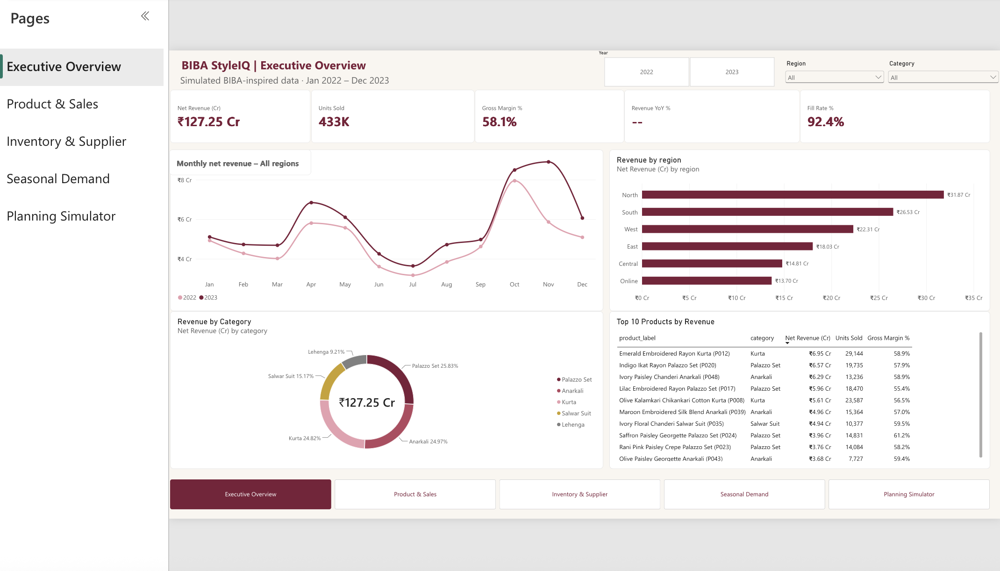
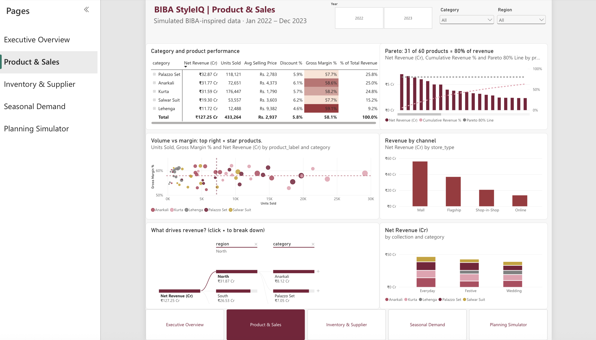
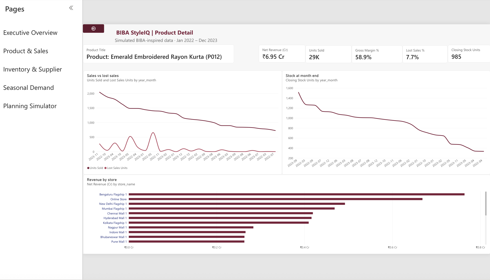
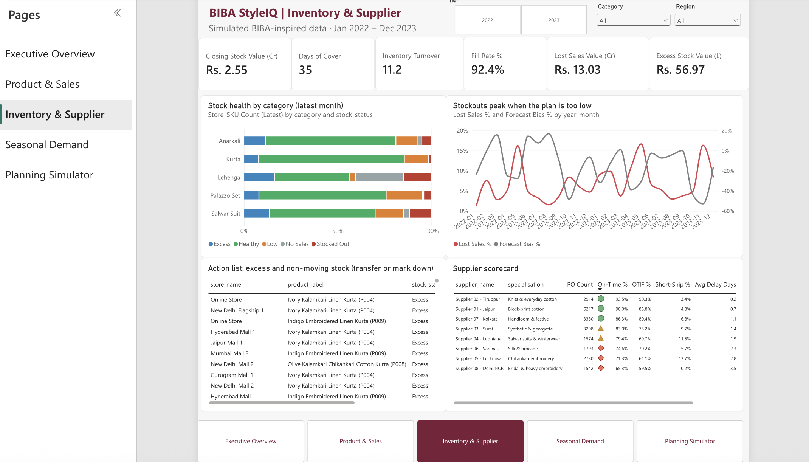
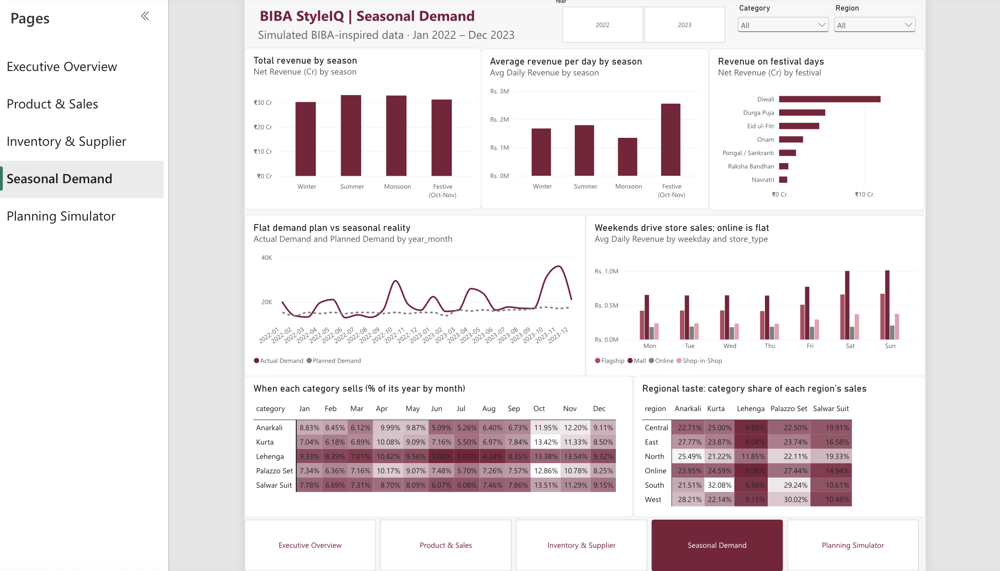
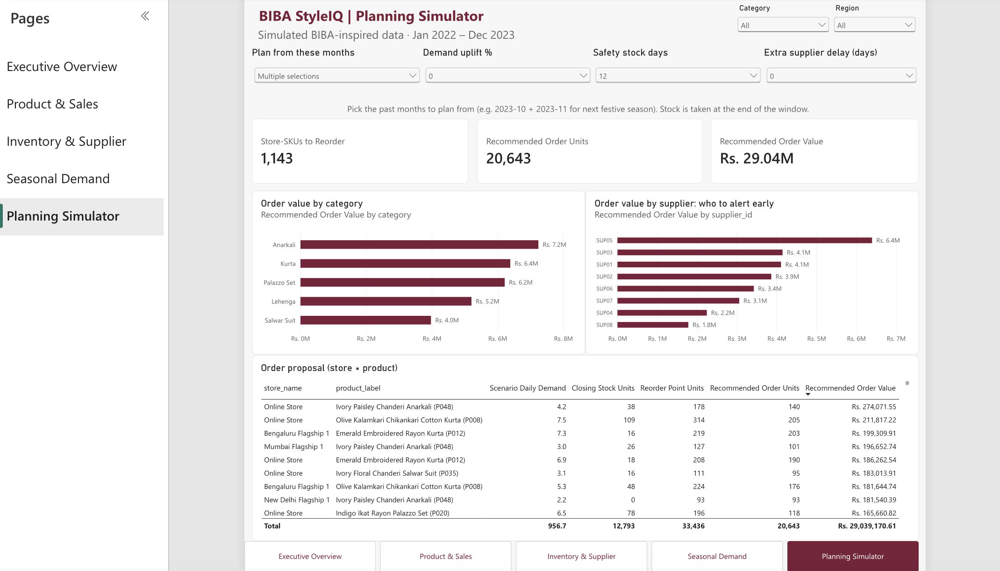

# BIBA StyleIQ: Fashion Retail & Supply Chain Intelligence (Power BI)

An end-to-end Power BI case study for an Indian ethnic-wear retailer: sales, seasonal demand, inventory health, supplier performance and a What-if replenishment simulator.

> **Disclosure:** this is a BIBA-inspired case study built on a **simulated dataset**. It is not BIBA's data, and it is not affiliated with or endorsed by BIBA. Public BIBA information was used only to make the product range, seasons and store formats realistic.

**Tools:** Microsoft Power BI (Service / web), DAX, data modelling, Excel, Ruby (data generation)

---

## Business problem

Ethnic-wear demand is highly seasonal. Festive and wedding months (Oct–Nov, Apr–May) sell about twice the monsoon rate, but the demand plan is close to a flat line. The result is stockouts on fast lines at the peaks and excess stock on over-planned lines at the same time. Some suppliers are also unreliable, which makes the peaks worse.

**Questions the report answers**
1. How is the business performing, and where does revenue come from?
2. Which products drive revenue and margin?
3. Where are we losing sales to stockouts, where is cash stuck in excess stock, and which suppliers are late?
4. How do seasons, festivals and regions shape demand, and does the plan follow it?
5. If we plan next season differently, how much should each store order?

## Data

7 tables in a star schema, Jan 2022 – Dec 2023 (about 326,000 rows in total):

| Table | Rows | Grain |
|---|---|---|
| Fact_Sales | 271,871 | one sales line (date × store × product) |
| Fact_Inventory_Monthly | 30,480 | store × product × month-end snapshot |
| Fact_Purchase_Orders | 23,418 | one purchase order |
| Dim_Date | 730 | day, with season, festival, sale-period and wedding-season flags |
| Dim_Product | 60 | SKU (category, collection, fabric, MRP, cost, supplier, lead time) |
| Dim_Store | 24 | store (city, region, store type incl. online) |
| Dim_Supplier | 8 | supplier (city, specialisation, contracted lead time) |

- The model has 3 fact tables and 4 dimensions, with 10 one-to-many, single-direction relationships.
- **Why simulated:** no public dataset has store-level sales, stock and purchase orders for an Indian fashion retailer. Popular "BIBA" datasets online turned out to be relabelled generic data (see `Documentation/BIBA_StyleIQ_Day1_Findings.md`).
- The generator script is in `Generator/`. The data dictionary is in `Dataset/README_Data.md`.
- Data quality checks (row counts, nulls, duplicates, referential integrity, stock balance) are in `Documentation/Data_Quality_Checks.xlsx`.

## Approach

1. **Data:** generated the 7 tables with realistic seasonality, festivals, regional taste, a −20% planning bias and supplier reliability, then quality-checked them.
2. **Model:** built a star schema and a marked date table, with sort-by columns (month, season, weekday).
3. **DAX:** wrote **63 measures** in 7 display folders. They cover:
   - sales and margin
   - time intelligence (YoY, MoM, FYTD with a 31 March year-end)
   - share and rank (RANKX, Pareto with ALLSELECTED)
   - semi-additive stock (last snapshot)
   - lost sales and forecast accuracy
   - supplier on-time, OTIF and short-ship
   - What-if scenarios (CROSSJOIN + SUMX with context transition)

   See `Documentation/DAX_Key_Measures.md`.
4. **Report:** 5 report pages, plus a drill-through page and a tooltip page. It uses:
   - synced slicers
   - conditional formatting and heat maps
   - a Pareto combo chart, a scatter chart and a decomposition tree
   - drill-through and a report-page tooltip
   - edit interactions, a dynamic title and a page navigator
5. **Simulator:** 3 What-if parameters (demand uplift, safety-stock days, supplier delay) drive store × SKU reorder points and order quantities.
6. **Validation:** every checkpoint was recalculated outside Power BI on the raw data.

It was built entirely in **Power BI Service (web)** on a Mac: semantic model editing, DAX and report authoring. Power Query isn't available in the web editor for uploaded files, so transformations were prepared upstream in the source workbook.

## Report pages

| Page | What it shows |
|---|---|
| 1. Executive Overview | KPI cards, monthly trend YoY, revenue by region and category, top 10 products |
| 2. Product & Sales | category → product matrix, Pareto (80/20), volume vs margin scatter, decomposition tree, channel and collection mix; drill-through to **Product Detail** |
| 3. Inventory & Supplier | stock health by category, lost sales vs forecast bias, excess-stock action list, supplier scorecard |
| 4. Seasonal Demand | revenue per day by season, festivals, flat plan vs actual demand, weekday pattern, category × month and region × category heat maps |
| 5. Planning Simulator | What-if parameters → reorder point, recommended order units and value by store × SKU, category and supplier |

### Screenshots








The full report is also in `PowerBI/BIBA_StyleIQ.pdf`.

## Key findings

- **Growth:** net revenue was **₹127.25 Cr** over two years, and 2023 grew **16.6%** (₹58.74 Cr → ₹68.50 Cr).
- **Seasonality:** season totals look similar, but **per day the festive season (₹25.6 L) sells 1.9× the monsoon rate (₹13.5 L)**. Diwali alone brings ₹11.98 Cr.
- **Lost sales:** **7.6% of demand was lost to stockouts (fill rate 92.4%), about ₹13 Cr at MRP**, concentrated in the festive and wedding peaks. At the same time **₹57 L sat in excess stock**.
- **Planning bias:** the demand plan runs about **20% below actual** and stays nearly flat (about 14–18K units a month) while actual demand peaks at **36K units in Nov 2023**.
- **Product concentration:** **31 of 60 SKUs make 80% of revenue**. Lehenga is only 9% of revenue but has the highest margin (59.1%).
- **Regional taste:** the South spends 32% on kurtas, the West 30% on palazzo sets, and the North has the highest bridal (lehenga) share.
- **Suppliers:** on-time delivery ranges from **65% (Delhi NCR) to 94% (Tiruppur)**, and OTIF from 60% to 90%. Lucknow (71% on-time) is the least reliable large supplier.
- **Simulator** (next festive season, planned from Oct–Nov 2023): the base order is **₹2.90 Cr**.
  - A 20% demand surge adds **31%**.
  - **A 10-day supplier delay adds 43%**.
  - Both together with a larger buffer reach **₹6.33 Cr (+118%)**.

  So lead-time reliability matters as much as forecasting. Details: `Documentation/Scenario_Results.md`.

## Recommendations

1. **Plan seasonally, not flat:** build the demand plan from daily run-rates per season and festival, and pre-build stock before October and April.
2. **Allocate by region:** set the stock mix by regional taste (kurtas South, palazzo West, bridal North) and add festival-specific stock (Onam South, Durga Puja East).
3. **Set safety stock by supplier reliability:** order earlier from, or hold more buffer for, Lucknow and Delhi NCR, and review contracts below 75% on-time.
4. **Protect the A items:** give the 31 SKUs that drive 80% of revenue the highest service level, and review the tail for range cuts.
5. **Clear excess:** use the action list to transfer stock between stores or mark down non-moving lines.

## Limitations

- The data is simulated. The patterns are realistic by design but don't describe BIBA's actual business.
- Only store stock is modelled; there is no warehouse or distribution-centre layer.
- Lost sales are known exactly only because the data is simulated. Real retailers have to estimate them.
- Stock-status thresholds, safety-stock days and lead times are assumptions.
- The simulator uses average daily demand over the chosen window. It does not forecast demand.

## Repository structure

```
Dataset/         7 CSV tables, the combined Excel workbook, data dictionary
Generator/       Ruby scripts that generate the dataset and workbook
Documentation/   day-by-day notes, guides, data quality checks, key DAX, scenario results
PowerBI/         report PDF export
Screenshots/     one image per report page
```

## How to open

The report was built in the Power BI Service. To rebuild it:
1. Upload `Dataset/BIBA_StyleIQ_Data.xlsx` to a Power BI workspace (or load the CSVs in Power BI Desktop).
2. Create the relationships described in `Documentation/BIBA_StyleIQ_Step_by_Step_Guide.md` (Day 4).
3. Add the measures from the guide (Day 5) and `Documentation/DAX_Key_Measures.md`.
